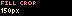

# Print Margin

Preview crop and white borders when a photo is fitted to a paper size.

A 1920×1080 photo fitted to 150×100 mm has 7.8 mm top and bottom borders.

Turn the wheel to browse results. Click to edit inputs, turn to change the selected value, click to select the next parameter, and press Start to return to results. Hold the wheel button in the editor to restore that parameter's starting value. Parameters persist on this device.

Inputs: Photo width (1 to 16000 px), Photo height (1 to 16000 px), Paper width (1 to 1500 mm), Paper height (1 to 1500 mm).

## Run locally

From this folder, run `~/.busy-emulator/bin/busy-emulator dev --once` with BUSY Bar Emulator open. Back exits.

