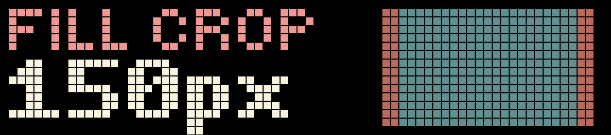
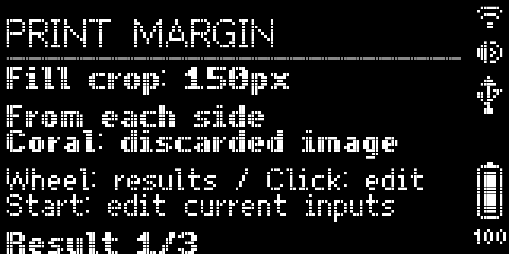
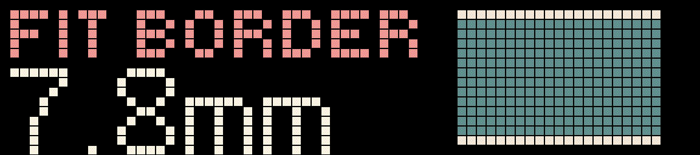

# Print Margin

Preview crop and white borders when a photo is fitted to a paper size.

Compare what the photo loses at the edges with the paper you would leave blank. The miniature uses different colors for discarded image and unprinted paper, so you can choose a print mode before sending the file.

## Screen transitions

Move between the filled frame and the whole-photo preview to see which edges fit.



<details>

<summary>Watch the rear display</summary>



</details>

## Preview a borderless fill

1. Click to enter photo width and height in pixels, followed by paper width and height in millimeters. Turn to change the selected field, click to advance, and press **Start** to return.
2. On **Fill crop**, coral shows the part of the photograph outside the paper shape. Read the number of source pixels removed from each affected edge.
3. Turn once for **Fit border** and compare the alternate preview.


## Keep the whole photograph

1. Read **Fit border** for the margin on each affected paper edge. The rear tells you whether the margins are horizontal or vertical.
2. Turn back to **Fill crop** to check what you would sacrifice to remove those margins. Browse onward to print density for the fitted image.
3. Change one paper dimension and compare the miniatures again. The app uses a centered layout.



## Example from the emulator

A 1920×1080 image fitted to 150×100 mm occupies 150×84.375 mm. The leftover height splits across two edges, about 7.8 mm each. Filling the same paper removes about 150 original pixels from each side.

## Run in the emulator

Open BUSY Bar Emulator. From this repository, run:

```sh
~/.busy-emulator/bin/busy-emulator dev --once
```

Press **Back** to exit.

The GIFs are excerpts from the emulator recording. Each LED occupies a 16 × 16 cell with a black border. The end frames pause for reading.

[Full recording](media/controls.mp4) · [Rear display](screenshots/back-1.png) · [Firmware test](EMULATOR-QA.md) · [MIT license](LICENSE)
